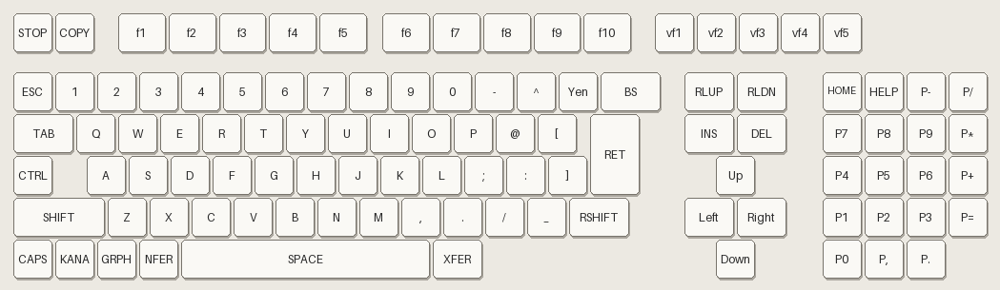

# How to use MS-DOS on the PC-98

PC-98 MS-DOS is the Japanese MS-DOS made for NEC's PC-98, on a Japanese PC-98 keyboard. The commands
are the same as on any MS-DOS, but the messages are in Japanese, the backslash shows as **¥**, and
several symbols sit on different keys than on an English keyboard. This page shows how to type in it
with the np2kai core's default key bindings in Chimera, the commands you need most, and how to work
with files, programs and floppy disks.

Tested 2026-11-08 on main 165c475 with MS-DOS 6.20, both the system floppy and the hard disk image
below. The keys, commands and messages on this page were typed and checked in the core.

## Getting to the prompt

| Slot | File | SHA-1 |
|---|---|---|
| Floppy disks | `MS-DOS 6.2 (199x)(Microsoft)(Disk 1 of 1)(System)[m].fdi` | 9555bb6c3702b0fc6070567432784447cfff3408 |
| Hard disks | `MS-DOS 6.20 (with extensions and update).hdi` | 0b36177cfb584d29588ff963ad47e2680ee304d8 |

Use either one (or both, see [Drives](#drives-and-paths)). Make the project as in
[How-to-run-fdi-files.md](How-to-run-fdi-files.md) and press Play.

- **The floppy** starts the FILMTN file manager. Press **Q** to leave it for the `A:¥>` prompt.
- **The hard disk** starts the MS-DOS Shell (a menu program). Press **Alt+F4** (GRPH+f.4) to leave
  it for the `A:¥>` prompt. Or press **Shift+F9** (SHIFT+f.9) for a prompt and type `EXIT` to go
  back to the Shell.

The prompt `A:¥>` means: you are on drive A, in its top folder (`¥`). It waits for a command; type
one and press **Enter**.

---

# Typing

## First: set Key Priority

Many keys you type are also Chimera hotkeys. By default Chimera does both: the key goes to the
PC-98 **and** runs the hotkey. Some of them would get in the way badly:

| Key | Chimera hotkey |
|---|---|
| F | Frame Advance |
| Q | Toggle read-only (movie) |
| Tab, Shift+Tab | Fast Forward, Turbo |
| Shift+R | Rewind |
| Minus, Equals, Shift+Equals | Decrease, Increase, Reset Speed |
| Ctrl+R | **Reboot Core** (throws away everything written to the disks) |
| F1 to F10 | Load Branch 1 to 10 (TAStudio) |
| Shift+F1 to Shift+F10 | Save Branch 1 to 10 (TAStudio) |
| R, M, Ctrl+M, Ctrl+B, Shift+F, Shift+S, Alt+R | TAStudio's Seek, Marker and other hotkeys |

So before you type, choose **Config > Key Priority > Input overrides Hotkeys**. Then a key that is
bound to a PC-98 key goes only to the PC-98. Keys the PC-98 doesn't use still work as hotkeys:
**Pause** still pauses Chimera (the PC-98 STOP key is Shift+Pause) and **F12** still takes a
screenshot (vf.2 is Ctrl+F12). The Key Priority icon in the status bar switches between the three
modes too, and you can bind a key to **Toggle Key Priority** in **Config > Hotkeys**.

## The keyboard



The core's default bindings put each PC-98 key on the key of an English keyboard that sits in the
same place. Letters, digits, Space, Enter and Backspace are where you expect them. Upper or lower case
does not matter to MS-DOS.

The symbols are where a Japanese keyboard has them, so several are not where the key's label says.
To type each symbol, press:

| To type | Press | | To type | Press |
|---|---|---|---|---|
| `¥` (the backslash `\`) | **`** (backtick, left of 1) | | `\|` | **Shift+`** |
| `/` | **/** | | `?` | **Shift+/** |
| `:` | **'** (apostrophe) | | `*` | **Shift+'** |
| `;` | **;** | | `+` | **Shift+;** |
| `@` | **[** | | `~` | **Shift+[** |
| `[` | **]** | | `{` | **Shift+]** |
| `]` | **\\** (the backslash key) | | `}` | **Shift+\\** |
| `^` | **=** | | `` ` `` | **Shift+=** |
| `-` | **-** | | `=` | **Shift+-** |
| `,` | **,** | | `<` | **Shift+,** |
| `.` | **.** | | `>` | **Shift+.** |
| `!` | **Shift+1** | | `"` | **Shift+2** |
| `#` | **Shift+3** | | `$` | **Shift+4** |
| `%` | **Shift+5** | | `&` | **Shift+6** |
| `'` | **Shift+7** | | `(` | **Shift+8** |
| `)` | **Shift+9** | | `_` | no key by default (see below) |

The ones that catch English typists: `:` is the apostrophe key (no Shift), `"` is Shift+2, `*` is
Shift+apostrophe, `+` is Shift+semicolon, `=` is Shift+minus and `\` is the backtick key. The number
pad's `*` `+` `-` `/` `.` keys type those symbols as they are.

**The underscore.** The PC-98's `_` key (right of `/`) has no default binding, because an English
keyboard has no key in that place. To type `_`, bind **Key Underscore** in **Config > Controllers**
(np2kai controller) to a key you don't use, for example the Menu key, then press **Shift** and that
key. Without Shift the key types nothing. Most of the time you can avoid `_` in names you make up.

## Special keys

| PC-98 key | Press (default) | What it does in MS-DOS |
|---|---|---|
| RETURN | **Enter** or keypad **Enter** | Runs the command you typed. |
| BS | **Backspace** | Deletes the last character you typed. |
| DEL | **Delete** | At the prompt, the same as Backspace. In editors, deletes the character under the cursor. |
| INS | **Insert** | Switches between inserting and typing over, in editors. |
| ← → ↑ ↓ | **Left**, **Right**, **Up**, **Down** | Move the cursor in editors and menus. At the prompt they don't: Left erases like Backspace and Right types `^L`. To fix a typing mistake at the prompt, erase back to it with Backspace, or throw the line away with Ctrl+C. |
| ESC | **Escape** | Used by programs. At the prompt it does **not** clear the line (it swallows the next key); use Ctrl+C. |
| STOP | **Shift+Pause** | Stops the running command or program, like Ctrl+C. At the prompt it throws away the line. |
| CTRL | **Ctrl** | **Ctrl+C** stops the running command, or throws away the line you are typing. |
| SHIFT | **Shift** (left), **Right Shift** | Capitals and the second symbol on a key. |
| GRPH | **Alt** | The PC-98's Alt: menus in Japanese programs (GRPH+f.4 leaves the MS-DOS Shell). |
| CAPS | **Caps Lock** | Capitals only **while you hold it**: the core does not lock CAPS. Use Shift. |
| KANA | **Ctrl+Scroll Lock** | Locks: tap it once to type half-width katakana, tap it again to go back to letters. If letters come out as katakana, kana is on: tap it again. |
| NFER, XFER | **Alt+,** and **Alt+.** | Used by Japanese input programs to convert text. Plain MS-DOS doesn't need them. |
| f.1 to f.10 | **F1** to **F10** | Program keys. In an editor or menu program they open menus. |
| vf.1, vf.2 | **Ctrl+F11**, **Ctrl+F12** | Extra function keys; few programs use them. vf.3 to vf.5 have no default key. |
| HOME CLR, HELP | **Home**, **End** | Used by some programs. |
| ROLL UP, ROLL DOWN | **Page Up**, **Page Down** | Page through text in editors and help. |

The white boxes along the bottom of the screen (`C1 CU CA S1 SU VOID NWL INS REP ^Z`) are labels for
f.1 to f.10 at the prompt. You can ignore them.

---

# Drives and paths

Each disk is a drive with a letter. **The disk the PC-98 started from is always A:**, so the letters
depend on what started:

| Started from | A: | B: | C: |
|---|---|---|---|
| A floppy (floppy in drive 1) | floppy drive 1 | floppy drive 2 | the hard disk |
| The hard disk (no bootable floppy in) | the hard disk | floppy drive 1 | floppy drive 2 |

A formatted floppy in drive 1 or 2 always wins the start over the hard disk. To start from the hard
disk with floppies in the project, set **Floppies at Start** to *None* and put them in later with
Swap (see [Floppy disks in Chimera](#floppy-disks-in-chimera)).

- **Change drive:** type the letter and a colon, for example `C:` and Enter. The prompt shows the
  new drive.
- **Folders** are called directories. `¥` separates them: `C:¥GAMES¥PUYO2` is folder PUYO2 inside
  folder GAMES on drive C. A path that starts with `¥` starts from the top folder of the drive.
- **Names** are at most 8 characters, a dot and at most 3 characters for the type, for example
  `README.DOC` or `INSTALL.EXE`. No spaces.
- **Wildcards:** `*` stands for any characters, `?` for one character. `*.EXE` is every .EXE file,
  `*.*` is every file.
- `.` is the folder you are in, `..` is the folder above it.

---

# The most common commands

Type the command, a space, then what it works on, and press Enter. **How to type it** gives the keys
for the symbols in the example.

| Command | What it does | Example | How to type it |
|---|---|---|---|
| `DIR` | Lists the files and folders where you are. | `DIR` | |
| `DIR /W` | The same, in columns (more fit on the screen). | `DIR /W` | `/` = **/** |
| `DIR /P` | Stops after each screen; press any key for the next. | `DIR ¥DOS /P` | `¥` = **`** |
| `DIR /S` | Searches all folders below for the files. | `DIR *.EXE /S` | `*` = **Shift+'** |
| `A:` `B:` `C:` | Changes to that drive. | `B:` | `:` = **'** |
| `CD` | Goes into a folder. Alone, it shows where you are. | `CD GAMES` | |
| `CD ..` | Goes up one folder. | `CD ..` | |
| `CD ¥` | Goes to the top folder of the drive. | `CD ¥` | `¥` = **`** |
| `MD` | Makes a folder. | `MD GAMES` | |
| `RD` | Removes an empty folder. | `RD GAMES` | |
| `COPY` | Copies files. With no destination, copies to where you are. | `COPY A:¥*.* B:` | |
| `XCOPY /S` | Copies a folder with everything in it. It asks whether the destination is a file or a directory (F/D): press **D**. | `XCOPY GAMES B:¥GAMES /S` | |
| `MOVE` | Moves a file to another folder or drive. | `MOVE SAVE.DAT ¥BACKUP` | |
| `REN` | Renames a file. | `REN OLD.TXT NEW.TXT` | |
| `DEL` | Deletes files. `DEL *.*` asks first (Y/N). | `DEL OLD.TXT` | |
| `DELTREE` | Deletes a folder and everything in it. Asks first (Y/N). | `DELTREE GAMES` | |
| `TYPE` | Shows a text file. | `TYPE AUTOEXEC.BAT` | |
| `TYPE ... \| MORE` | Shows it a screen at a time. | `TYPE README.DOC \| MORE` | `\|` = **Shift+`** |
| `SEDIT` | The full-screen text editor (see below). | `SEDIT CONFIG.SYS` | |
| `FORMAT` | Formats a floppy (see below). Erases it. | `FORMAT B:` | |
| `MEM` | Shows how much memory is free. | `MEM` | |
| `VER` | Shows the MS-DOS version. | `VER` | |
| `CLS` | Clears the screen. | `CLS` | |
| `HELP` | MS-DOS's help, in Japanese. Leave it with **Alt**, **F**, **X**. | `HELP` | |
| `/?` | Short help for one command. | `COPY /?` | `?` = **Shift+/** |
| `EXIT` | Goes back to the program you came from (the MS-DOS Shell). | `EXIT` | |

`DIR`, `CD`, `MD`, `RD`, `COPY`, `REN`, `DEL`, `TYPE`, `CLS`, `VER` and `EXIT` are built into MS-DOS
and always work. The others are programs in the `¥DOS` folder. The hard disk image has all of them.
The system floppy's `¥DOS` has only a few (FORMAT, DISKCOPY, SYS, SCANDISK and the drivers), so
started from the floppy, `MOVE`, `MEM`, `XCOPY`, `DELTREE`, `SEDIT` and `HELP` answer
コマンドまたはファイル名が違います (bad command). With the hard disk in the project as C:, type
`PATH A:¥DOS;C:¥DOS` once and they all work.

## Example: making, copying, renaming, moving and deleting

Started from the hard disk (A:), each line followed by Enter:

```
MD GAMES                  make a folder GAMES
CD GAMES                  go into it; the prompt is now A:¥GAMES>
COPY ¥AUTOEXEC.BAT        copy AUTOEXEC.BAT from the top folder to here
REN AUTOEXEC.BAT AUTO.TXT rename the copy
MOVE AUTO.TXT ¥           move it to the top folder
DEL ¥AUTO.TXT             delete it
CD ..                     go back up
RD GAMES                  remove the now empty folder
```

`RD` only removes an empty folder; for a folder with files in it use `DELTREE GAMES` and answer **Y**.

---

# Running programs

A program is a file ending in `.EXE`, `.COM` or `.BAT` (a batch file: a list of commands). To run
one, type its name **without** the ending and press Enter:

```
CD ¥GAMES¥PUYO2
PUYO2
```

or give the whole path: `A:¥GAMES¥PUYO2¥PUYO2`. MS-DOS looks in the folder you are in and then in
the folders on the PATH (`¥DOS` and the top folder on these disks). If it finds nothing it answers
コマンドまたはファイル名が違います: check the name with `DIR *.EXE`, `DIR *.COM` and `DIR *.BAT`, or
go into the program's folder first.

A game's installer is usually `INSTALL` or `SETUP`. Its README is usually a `.DOC` or `.TXT` file:
`TYPE README.DOC | MORE`.

To stop a command or program that is running, press **Ctrl+C** or **Shift+Pause** (STOP). Most
games have their own way to quit; some can only be left with the **Reset** input.

---

# Editing a text file with SEDIT

MS-DOS 6.2 for the PC-98 has no `EDIT`; its editor is `SEDIT` (on the hard disk image). Its menus are
in Japanese, so here is the one you need. This makes and runs a small batch file:

1. Type `SEDIT HELLO.BAT` and Enter. An empty file opens (a new name makes a new file; an existing
   name opens that file).
2. Type `ECHO Hello from PC-98` and Enter. Move with the arrow keys, delete with Backspace or
   Delete, as in any editor.
3. Press **F1** (f.1, ファイル). The file menu opens:
   - **E**: save and quit (ファイルのセーブと編集終了)
   - **S**: save and keep editing
   - **Q**: quit without saving
4. Press **E**. You are back at the prompt.
5. Type `HELLO` and Enter: the batch file runs and prints `Hello from PC-98`.
6. Type `DEL HELLO.BAT` to delete it again.

F1 is TAStudio's Load Branch 1 hotkey: set Key Priority to **Input overrides Hotkeys** first (see
[Typing](#first-set-key-priority)).

---

# Floppy disks in Chimera

## Changing disks

The core's inputs **Drive 1/2 Next Floppy Disk**, **Previous**, **Swap** and **Eject** change the
disk in a drive while MS-DOS runs. They have no default key: bind them in **Config > Controllers**
(np2kai controller). Next and Previous move the drive's pointer along the project's list of floppies;
Swap puts that floppy in the drive. [How-to-run-fdi-files.md](How-to-run-fdi-files.md) explains them
in full.

Remember which drive letter is which drive (see [Drives and paths](#drives-and-paths)). After a swap,
just use the drive again (`DIR B:`): MS-DOS reads the new disk.

## Formatting a blank floppy

Put an unformatted or blank floppy (for example `Unformatted blank 1.d88`) in a drive, then:

1. Type `FORMAT B:` (the floppy's drive letter) and Enter.
2. 新しいディスクをドライブ B: に挿入し どれかキーを押してください (insert a disk in B: and press a key):
   press **Enter**.
3. ディスクのタイプは 1 : 2DD(640KB) 2 : 2HD(1MB) (which disk type): type **2** and **Enter** for a
   normal 1.2 MB disk.
4. It formats (the bar fills to 100) and asks 別のディスクをフォーマットしますか(Y/N) (format another?):
   type **N** and **Enter**.

Never format the drive you started from or the hard disk.

## A drive with nothing readable in it

Changing to a drive whose floppy isn't formatted, or that is empty, gives:

```
セクタが見つかりません. 読み取り中 ドライブ B
中止(A), 再試行(R), 失敗(F)?
```

(sector not found reading drive B: Abort, Retry, Fail?). Press **F**, then type another drive, such
as `A:`, and Enter.

## Keeping what you wrote

Everything MS-DOS writes to a disk stays in the running machine. The **Reset** input keeps it.
Chimera's **Reboot Core** (Ctrl+R) and changing **File > Project Settings** load the project's files
again and lose it. To keep the disks, use **Emulator > Export Save Data**.

---

# Japanese messages

| Message | Meaning |
|---|---|
| コマンドまたはファイル名が違います. | Bad command or file name. |
| ファイルが見つかりません. | File not found. |
| パスが見つかりません. | Path not found. |
| ディレクトリの指定が違います. | Invalid directory. |
| パスの指定が違うか, ディレクトリでないか, または空ではありません. | Invalid path, not a directory, or directory not empty (RD). |
| 無効なスイッチです. | Invalid switch (an option after `/` this command doesn't have). |
| 1 個のファイルをコピーしました. | 1 file(s) copied. |
| 15 個 / バイトのファイルがあります / バイトの空きがあります | 15 files / bytes in files / bytes free (DIR). |
| ドライブ A: のボリュームラベルはありません. | Volume in drive A has no label. |
| ディレクトリは A:¥DOS | Directory of A:¥DOS. |
| 続けるにはどれかキーを押してください . . . | Press any key to continue . . . |
| よろしいですか (Y/N)? | Are you sure (Y/N)? |
| 中止(A), 再試行(R), 失敗(F)? | Abort, Retry, Fail? |
| 現在のドライブはもう有効ではありません. | Current drive is no longer valid (type `A:`). |

## Troubleshooting

| What you see | What to do |
|---|---|
| Typing pauses or fast-forwards Chimera, or loads a branch | Set **Config > Key Priority > Input overrides Hotkeys**. |
| `'` gives `:`, Shift+2 gives `"`, `\` shows as `¥` | That is the PC-98 layout. See the symbol table above. |
| Letters come out as katakana | KANA is on. Press **Ctrl+Scroll Lock** once. |
| コマンドまたはファイル名が違います | The program isn't here or on the PATH. Go into its folder, or check the name with `DIR`. |
| 中止(A), 再試行(R), 失敗(F)? | The drive has no readable disk. Press **F** and change to another drive. |
| A program won't stop | **Ctrl+C** or **Shift+Pause** (STOP); if that does nothing, the **Reset** input. |
